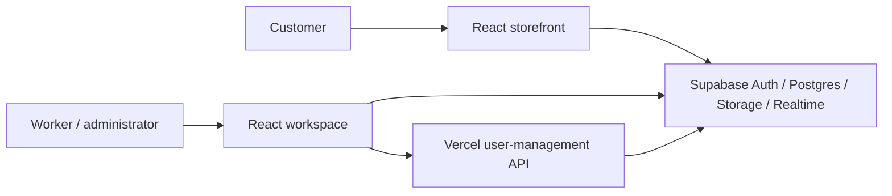

# GearLane Auto Parts

A Malaysian automotive ecommerce system with customer shopping, worker operations and administrator management. Built with React, Vite and Supabase, with Vercel hosting and a server-side user-management API.

The system includes a researched 56-product catalogue, manual bank-transfer checkout, inventory reservations, product-attached customer support, purchase-verified reviews, refund handling and interactive business analytics. A separate local preview supports demonstrations without creating live orders.

The responsive interface guides new shoppers through finding parts, checking their cart, entering delivery details, reviewing the order and completing bank transfer. Product cards use labelled actions, cart confirmation links directly to the cart, and each order explains who acts next. A How to order guide is available from navigation. Guest cart items are retained when a customer signs in, including a session established after email confirmation.

Typography uses self-hosted Manrope variable fonts across customer and staff screens, with system fallbacks and `font-display: swap` so text stays visible while fonts load. The font files and their open font licence are supplied by `@fontsource-variable/manrope`; no Google Fonts connection is required.

The customer design uses navy, warm neutrals and amber actions, with a service-focused homepage, a varied cross-category selection, keyboard-accessible search suggestions and category shortcuts. Product details, cart, checkout, account pages, order tracking and staff tools share the same visual language. The homepage selection is curated by category and is not labelled as a sales ranking.

The homepage now uses a larger service showcase, illustrated category icons, focused category tiles and subtle entrance/action animations. Optional promotion advertisements appear above the showcase only when published images exist. Staff tools load in a separate JavaScript chunk; live catalogue data is cached for up to 15 seconds per account/role, with invalidation after relevant writes and realtime changes. Route-specific reads avoid fetching orders, refunds and staff records when browsing the catalogue. Stock and checkout totals remain authoritative in database functions. These reduce frontend work; they do not guarantee database response times.

Feedback includes real loading skeletons, an illustrated animated 404, empty states, animated registration success and order confirmation. Email confirmation is shown as a separate next step rather than claiming the user is signed in. Order confirmation explicitly states that bank transfer is still required. Toasts announce actions, offer View cart or Undo where appropriate, pause dismissal on hover/focus, and do not take keyboard focus. Clearing the entire cart asks for confirmation. Motion respects `prefers-reduced-motion`; decorative entrance animations run once, and loading animations only represent actual pending work.

Design references: [Baymard product filtering guidance](https://baymard.com/blog/ecommerce-filter-ui), [NN/g loading and interruption guidance](https://www.nngroup.com/articles/designing-for-waits-and-interruptions/), [W3C status messages](https://www.w3.org/WAI/WCAG22/Understanding/status-messages.html), and [W3C animation from interactions](https://www.w3.org/WAI/WCAG22/Understanding/animation-from-interactions.html). These informed implementation choices; no sales uplift or accessibility certification is implied.

Phone layouts include bottom navigation, expandable catalogue filters and labelled admin record cards. Tablet and desktop layouts use wider grids, a catalogue filter sidebar and grouped workspace navigation. The staff overview links directly to pending-payment, preparation and refund queues; administrators also see a setup checklist while checkout is disabled.

**Release scope:** an implemented first release. Store configuration and authenticated deployment acceptance testing are required before accepting real orders. See [verification and security boundaries](#verification-and-security-boundaries) for tested coverage and current limits.

## Contents

- [Technology and architecture](#technology-and-architecture)
- [Run locally](#run-locally)
- [Database and first administrator](#database-and-first-administrator)
- [What each role can do](#what-each-role-can-do)
- [Checkout, payment and refund rules](#checkout-payment-and-refund-rules)
- [Deploy on Vercel](#deploy-on-vercel)
- [Product evidence and photographs](#product-evidence-and-photographs)
- [Project structure and commands](#project-structure-and-commands)
- [Troubleshooting](#troubleshooting)
- [Verification and security boundaries](#verification-and-security-boundaries)
- [Contributing, security and licensing](#contributing-security-and-licensing)

## Technology and architecture

| Layer | Implementation |
| --- | --- |
| Frontend | React, Vite, JavaScript/JSX, responsive CSS and Lucide icons |
| Validation | Zod in the application and database constraints/validated functions |
| Authentication | Supabase Auth with customer, worker and administrator roles |
| Database | Supabase Postgres, row-level security and transactional RPC functions |
| Files | Public product images and private payment receipts in Supabase Storage |
| Updates | Supabase Realtime for operational records and conversations |
| Server API | Vercel Node function for privileged user invitation and deletion |
| Verification | Node test runner, PGlite database tests and Playwright browser checks |



Ordinary commerce writes use role-checked database functions. Only the privileged user-management API requires a server-side service-role key. A separate Render backend is not required for this release.

## Run locally

Requires Node.js 22.12+ and npm; Node 24 was used for verification. Use the committed lockfile with `npm ci`.

For a standalone repository, place the **contents of `automotive/`** at the new repository root:

```sh
git clone https://github.com/YOUR_USERNAME/gearlane-auto-parts.git
cd gearlane-auto-parts
npm ci
```

Replace `YOUR_USERNAME` with the repository owner. If you retain the current parent repository, run commands inside `automotive/` instead. The existing proposal and other store demos are separate projects.

For live mode, create your local configuration before starting:

```powershell
Copy-Item .env.example .env.local
```

On macOS/Linux, use `cp .env.example .env.local`. Fill in `VITE_SUPABASE_URL` and `VITE_SUPABASE_PUBLISHABLE_KEY`, leave `VITE_DEMO_MODE=false`, and complete the database setup below. Do not overwrite an existing configured `.env.local`.

```sh
npm run dev
```

Open the URL Vite prints, normally `http://127.0.0.1:5173`. `.env.local` is ignored by Git and must be created in each checkout. Never commit server secrets.

For an isolated demonstration with sample inventory and accounts:

```powershell
npm run dev:demo
```

The yellow banner identifies preview mode. Its records live in this browser's local storage, not Supabase. Customer, worker and admin account selectors appear on the sign-in page. These credentials grant no live access. To reset the demonstration, remove the `gearlane_preview_v1` local-storage entry and reload. Sign-in is per tab, so separate tabs can demonstrate different roles. Preview accounts use the displayed fixed passwords; no actual emails, deposits, orders or transfers occur.

| Preview role | Email | Password |
| --- | --- | --- |
| Customer | `customer@gearlane.demo` | `DemoCustomer123!` |
| Worker | `worker@gearlane.demo` | `DemoWorker123!` |
| Admin | `admin@gearlane.demo` | `DemoAdmin123!` |

These are deliberately public **local preview credentials**, not production accounts. Main routes are `/`, `/shop`, `/products/:id`, `/wishlist`, `/cart`, `/checkout`, `/account`, `/orders`, `/orders/:id`, `/messages` and `/workspace`. Workspace navigation is determined by the signed-in role.

## Database and first administrator

Do not rerun the entire setup on an initialized project: its policy creation is intended for a fresh project. For an older project with only the original setup, apply `supabase/006-checkout-hardening.sql` separately. Migration 006 adds a bank-instruction snapshot for new orders, limits repeated unpaid reservations and allows removing archived wishlist items. The current fresh-project setup already incorporates these changes.

For a new Supabase project, review and run the current `supabase/setup.sql` once in SQL Editor. It already includes the hardening changes. The individual scripts are retained for review. Storage buckets and realtime publication membership are created by setup. `npm run seed:sql` regenerates the catalogue seed and fresh-project setup; it does not contact the database.

For an existing project, also review and run `supabase/007-chat-delivery.sql` before deploying the conversation update. It preserves existing messages and adds a client-message delivery reference and the role-checked `send_chat_message` function. Retrying the same message reference returns its existing ID instead of inserting a duplicate. Fresh-project `setup.sql` already includes migration 007. The original `send_message` function is retained for backward compatibility; the current interface uses the delivery-aware function.

For existing projects adding homepage advertisements, review and run `supabase/008-promotion-banners.sql` once. It creates banner records, admin-only write functions, a public image bucket with admin-only uploads, and realtime updates. Fresh-project `setup.sql` includes migration 008. Do not rerun the complete setup on an existing project. No extra environment variables or service-role key are needed for banner management.

1. Create your own customer account at `/account` and complete email confirmation if enabled.
2. As project owner, use SQL Editor to promote that specific account. Replace the example address:

```sql
update public.profiles
set role = 'admin', is_active = true
where lower(email) = lower('YOUR_REGISTERED_EMAIL');

select email, role, is_active
from public.profiles
where lower(email) = lower('YOUR_REGISTERED_EMAIL');
```

3. Sign out and sign back in, then open `/workspace`. Never grant admin based on signup metadata. Future user-role changes use the admin screen and protected database function.
4. In Store settings, enter the company's actual bank account, delivery charge, free-delivery threshold and return policy. In Products, confirm actual selling prices, available inventory, vehicle fitment and authorised photographs. Then enable checkout.

Live products deliberately start with **zero inventory and unconfirmed selling prices**. This prevents selling stock the company does not have. Orders placed before migration 006 use current bank settings as a fallback; orders placed after it preserve the instructions used when ordering.

## What each role can do

| Role | Included workflows |
| --- | --- |
| Customer | Browse/search/filter/sort products; product specifications and source references; wishlist; quantity-based cart; Malaysian delivery address; promotion codes; bank-transfer checkout; private optional receipt upload; order history and tracking; cancel eligible unpaid orders; confirm receipt; review received purchases once; request a full-order refund; private seller chat with optional product attachment; profile and password recovery; in-app notifications. |
| Worker | View orders and history; verify or reject submitted bank references after checking actual deposits; prepare, ship and record delivery with carrier/tracking details; review refund requests and record whether goods returned; reply to customer enquiries and reviews; private staff-to-staff conversations; request stock from admins; release expired unpaid reservations. |
| Admin | Worker operations plus product creation/editing/archiving and image upload; user invitations, role changes, deactivation and eligible deletion; announcement, promotion and homepage banner CRUD; store/bank/delivery/policy settings; stock receipts; record completed refund transfers; review moderation with reason; audit history; interactive analytics. |

### Homepage promotion banners

Sign in as an administrator and open **Workspace → Promotion banners** (`/workspace/banners`). Add a banner name, upload its main artwork, provide a descriptive advertisement text and optionally select a destination inside the store. Smaller display-order numbers appear first. Save unpublished artwork as a draft, or select **Publish on the homepage**. Existing banners can be edited, published, hidden or deleted. Concurrent edits are checked with a version number to prevent overwriting another administrator's changes.

Uploads accept JPG, PNG and WebP up to 5 MB, with decoded dimensions no larger than 6000 × 6000 pixels. Live uploads resize and encode to WebP. Recommended artwork is **1920 × 640** for desktop and an optional **960 × 480** phone design. Artwork fits inside its frame without cropping its text. Images are public advertising assets; never upload private information. Deleting a banner removes its record, while its uploaded files remain in Storage for deliberate asset cleanup.

The carousel supports touch scrolling, arrows, position indicators and optional six-second playback. Playback starts only when selected, pauses on hover/hidden tabs, stops on keyboard focus, and is disabled with reduced motion. Missing published images hide the entire section; failed image downloads are removed from the carousel. Loading images use a skeleton placeholder. With no published banners, the regular homepage starts immediately.

Design references include [AutoZone's search/category shopping structure](https://www.autozone.com/), [Baymard's carousel controls research](https://baymard.com/blog/page-control-ui), [W3C carousel guidance](https://www.w3.org/WAI/tutorials/carousels/) and [NN/g skeleton-screen guidance](https://www.nngroup.com/articles/skeleton-screens/). The implementation uses original artwork and existing application styles rather than copied retailer assets.

Products are archived to preserve historical orders. Accounts with orders or related records should be deactivated rather than deleted. Promotions referenced by orders are disabled rather than erasing history. Chats are human support inboxes, not an AI fitment bot. Staff can attach a product when replying. Internal conversations are visible only to their members.

### Conversation system

Customer support and private staff chat use a persistent conversation view with message history, optional support-product attachments and sender timestamps. Supabase Realtime updates are supplemented by automatic **five-second polling** while the page is open. Sync also runs after reconnection or returning to the tab. Requests are coalesced to prevent overlapping polls, and timers/listeners are removed when leaving chat. Browser background-tab throttling and network delays can affect exact timing.

Each send shows a pending bubble, locks the Send button and keeps the draft until delivery is confirmed. An unconfirmed send offers an explicit retry using the same unique reference, or Keep as draft. Draft references survive that action so an unchanged retry remains duplicate-safe. Drafts are held in page memory per conversation, not saved to local storage; leaving/reloading the page discards unsent draft text. A successful server response is shown as Sent, not as proof that the recipient has read the message.

Incoming sync preserves loaded older history. Reading older messages does not force the view to jump; a New messages button returns to the latest message. Enter sends a message, Shift+Enter inserts a line break, and composition input is respected. Closed conversations reject new sends. Customer-support attachments must reference an active product; private staff conversations do not accept product attachments.

The interface and delivery-aware database function validate meaningful text, the 2,000-character limit, unsupported control characters, conversation access and product attachment eligibility. The database also enforces its message rate limit and active membership. Messages are rendered as escaped plain text. A visible reminder asks everyone to avoid sharing passwords, OTP/TAC codes, PINs, card numbers, CVV codes and other private sensitive information, and directs payment receipts to the order page. This reminder is guidance, not automated sensitive-data detection or an end-to-end encryption claim.

Implementation references: [Supabase Postgres Changes](https://supabase.com/docs/guides/realtime/postgres-changes), [React effect cleanup](https://react.dev/reference/react/useEffect), and [OWASP input validation](https://cheatsheetseries.owasp.org/cheatsheets/Input_Validation_Cheat_Sheet.html).

Analytics include verified paid order value, average paid order, active signed-in customers, customer account types, category purchases, wishlist categories and customer activity by Malaysia hour. Period controls support 7/30/90 days; chart bars and breakdowns are clickable. Sales are grouped by order creation date and exclude completed paid refunds. Category value is before order-level discounts. Account-type and wishlist breakdowns are all-time; activity excludes anonymous visitors. These are operational sales metrics, not profit or attribution reporting.

## Checkout, payment and refund rules

- The database calculates prices, discounts, delivery and totals. Browser-submitted totals cannot set the price. Integer cents avoid decimal rounding errors.
- Product-row locks protect stock reservations. Idempotency keys prevent an interrupted checkout retry from creating a second order. The server rejects missing/unavailable products, unconfirmed prices, insufficient stock, duplicate cart lines and invalid quantities.
- At most five orders per minute and five awaiting-payment orders per customer are allowed. Staff can release unpaid/rejected-payment reservations older than 24 hours. This is a staff action in this release, not a scheduled job. Submitted transfers remain reserved for investigation.
- Customers transfer outside the app, then submit a reference and optional private receipt. Staff must check the actual business bank deposit; an uploaded screenshot does not verify funds. Verification moves the order to preparation.
- Dispatch requires carrier and tracking details. Staff delivery marking does not grant review eligibility: the buyer must confirm receipt. Only one review per purchased product per order is accepted.
- Unpaid/unsubmitted orders may be cancelled and stock is restored once. Paid or submitted-payment orders use staff review/refund handling.
- Refunds cover the entire order. Approval does not send money. After making the real transfer outside the app, an admin records its reference. Stock is restored only when returned goods have been confirmed and the admin selects restock. Partial refunds and exchanges are outside this release.

## Deploy on Vercel

1. Push the project to GitHub and import the repository in Vercel.
2. For the standalone `gearlane-auto-parts` repository, leave **Root Directory** at the repository root. If using the parent repository, set it to `automotive`. Select framework Vite, build `npm run build`, output `dist`. The included `vercel.json` supplies SPA routing and response-security headers. Vercel deploys `api/admin-users.js` as a Node function.
3. Configure browser variables in Vercel:

| Variable | Value |
| --- | --- |
| `VITE_SUPABASE_URL` | Your Supabase project URL |
| `VITE_SUPABASE_PUBLISHABLE_KEY` | Public publishable/anon key |
| `VITE_DEMO_MODE` | `false` for the real store |
| `VITE_COMPANY_NAME` | `GearLane Auto Parts` |

4. Configure server variables for auth-user invitations/deletion:

| Variable | Value |
| --- | --- |
| `SUPABASE_URL` | Same project URL |
| `SUPABASE_PUBLISHABLE_KEY` | Same public key |
| `SUPABASE_SERVICE_ROLE_KEY` | Server-only service-role key from the Supabase dashboard; never use a `VITE_` prefix |
| `SITE_URL` | Exact deployed origin, e.g. `https://your-store.vercel.app` |

5. In Supabase Authentication URL Configuration, set Site URL to the deployed origin and allow the actual `/account` and `/account?reset=1` redirect URLs for production and local development. Configure reliable SMTP email delivery and appropriate Auth rate limits before onboarding customers. Keep email confirmation enabled for public registration. Configure Supabase's password policy to match the app's minimum 12-character registration rule.
6. Redeploy after changing Vite variables; they are embedded at build time. Check registration, confirmation, invitation, recovery, private receipt upload and one controlled end-to-end purchase with your actual project. Only enable real checkout once bank, prices, stock, delivery and policies are checked.

The Vite development server does not execute Vercel API functions. Normal live commerce and role editing work directly through Supabase; local live invitation/deletion requires `vercel dev` with server environment variables, or a Vercel deployment. Without server configuration, that endpoint fails closed with a setup message. Never embed a service-role key in this project's browser configuration.

GitHub Pages can host a frontend demonstration, but cannot execute the included user-management API. Vercel is the intended deployment target. Service plans and usage quotas must be checked against your business volume.

## Product evidence and photographs

`data/catalogue.json` contains **56 automotive products across 11 categories**: engine oils, transmission fluids, brake fluids, coolant, filters, spark plugs, steering fluid, brake pads, exhaust components, wipers and cleaner/additive. Names, MYR prices, supplier-described specifications and direct listing links are preserved per item, with a research observation date of **28 October 2026**. `data/research-notes.json` records evidence limitations and listing inconsistencies.

45 products have product-detail price evidence; 11 use a supplier category's displayed price with a separate price-evidence URL. Reference prices can change and are not GearLane's selling offers. Supplier application descriptions do not guarantee compatibility; confirm model, year, engine, chassis code and part number. Product sources do not imply a partnership or authentication of a physical item. Some supplier brands are explicitly unspecified.

No supplier product photographs were copied. The interface uses original category illustrations labelled as such. Admins can upload store-owned/authorised JPG, PNG or WebP product images, or supply an authorised HTTPS image URL. Broken external images fall back to the illustration. Receipt uploads are private, limited to JPG/PNG/PDF and 5 MB; staff use short-lived signed links to view them.

## Project structure and commands

Paths below are relative to the application root, whether this is the standalone repository or `automotive/` in the parent repository.

```text
.
├── .github/                 CI workflow, issue and pull request templates
├── api/admin-users.js       Server-side auth-user administration
├── data/                    Researched catalogue and evidence notes
├── public/                  Public static assets
├── scripts/                 Seed generation and browser/connection checks
├── src/
│   ├── App.jsx              Routing, session and application state
│   ├── customer-pages.jsx   Shopping, orders, account and support screens
│   ├── workspace-pages.jsx  Worker and admin screens
│   ├── repository.mjs       Live Supabase integration
│   ├── preview-repository.mjs  Isolated browser-based demonstration data
│   ├── domain.mjs           Validation, money and commerce helpers
│   └── *.css               Responsive storefront and workspace styling
├── supabase/                Schema, protected functions, policies and seed SQL
├── tests/                   Domain, API and Postgres permission/workflow tests
├── .env.example             Configuration template without credentials
├── vercel.json              Deployment routing and response headers
└── package.json             Application dependencies and commands
```

| Command | Purpose |
| --- | --- |
| `npm ci` | Install the lockfile's dependency versions |
| `npm run dev` | Start local development with configured environment |
| `npm run dev:demo` | Start the explicitly labelled local preview |
| `npm run build` | Create the frontend production build in `dist/` |
| `npm run preview` | Preview the built frontend locally; does not run Vercel functions |
| `npm test` | Run domain, API and database tests |
| `npm run test:browser` | Run preview browser workflows; requires Chromium and free port 5188 |
| `npm run test:responsive` | Check guided flows and layouts from 320px to 1920px; requires Chromium and free port 5189 |
| `npm run test:chat` | Check two-way chat polling, pending sends, retries, privacy and history; requires Chromium and free port 5190 |
| `npm run test:experience` | Check customer search, cart feedback, registration, loading/success/error states and motion; requires Chromium and free port 5191 |
| `npm run test:banners` | Check banner uploads, drafts, publishing, phone artwork, controls, access boundaries and scoped loading; requires Chromium and free port 5192 |
| `npm run seed:sql` | Regenerate seed/setup SQL files without applying them |
| `node scripts/check-connection.mjs` | Read public catalogue connectivity using `.env.local` |
| `node scripts/live-browser-check.mjs` | Inspect the live local app already running on port 5173 |

The [CI workflow](.github/workflows/ci.yml) installs dependencies, runs automated tests, builds the frontend and checks preview workflows in Chromium. It requires no live Supabase credentials. GitHub discovers this workflow when `.github/` is at the **repository root**; it is not active while nested under `automotive/` in the parent repository.

## Troubleshooting

| Symptom | Check |
| --- | --- |
| Store setup or connection error | Verify the public environment variables, project availability and database setup; restart Vite after changing environment files. |
| Unexpected local preview | Run live mode with both public variables present and `VITE_DEMO_MODE=false`. Production demonstrations must explicitly opt into preview mode. |
| No admin workspace access | Confirm the account exists, the owner-granted profile role is `admin`, and the account is active; sign out and sign in again. |
| Cannot purchase catalogue items | Confirm actual prices and stock in Products, bank details in Store settings and checkout enabled. Researched prices do not automatically become selling prices. |
| Transfer remains submitted | A worker/admin must verify the actual deposit before preparing the order. No automated bank matching runs. |
| Review button missing | The buyer must confirm receipt of a paid order. A product already reviewed for that order cannot be reviewed again. |
| Invitation/deletion fails locally | Use a Vercel environment with the server-only variables; Vite alone does not run the API. Confirm `SITE_URL` matches the requesting origin. |
| Confirmation/recovery email missing | Check Supabase Auth redirect configuration, SMTP delivery and email logs, plus the recipient's spam folder. |
| Receipt link expires | Use View private receipt again to generate a new short-lived signed link. |
| Browser tests cannot start | Install Chromium using `npx playwright install chromium` and ensure port 5188 is available. |

## Verification and security boundaries

```powershell
npm test
npm run build
npx playwright install chromium
npm run test:browser
npm run test:responsive
npm run test:chat
npm run test:experience
npm run test:banners
```

The automated database test runs real Postgres through PGlite with mock Supabase Auth/Storage scaffolding. It exercises role checks, RLS customer isolation, metadata privilege escalation prevention, authoritative prices, stock, idempotency, payment/fulfilment/refund transitions, received-only reviews, chat membership, stock receipts and the incremental migration. Domain tests cover money and input validation. API tests cover authentication, origin/role checks, validation, invitation success and self-deletion rejection. Browser tests exercise the customer/worker/admin preview, checkout/payment/dispatch/receipt flows, product-attached chat, interactive analytics, mobile overflow and missing pages. Screenshots are in ignored `.generated/`.

Responsive checks cover customer and admin pages at 320, 390, 768, 1024, 1440 and 1920 pixels, plus worker pages at phone, tablet and desktop widths. They check horizontal overflow, filter open/close behaviour, guest-cart continuity, checkout validation and address editing, shopping guidance, mobile workspace navigation and queue filters. Screenshots are saved to `.generated/responsive/`. These are automated browser checks, not a substitute for usability sessions with real shoppers or physical-device testing.

Chat tests suppress preview push events to verify the five-second polling fallback between customer and worker tabs. They exercise pending-send locking, repeat-submit prevention, ambiguous connection failure and duplicate-safe retry, offline drafts, history preservation, private staff membership, closed conversations and polling cleanup. Unit tests cover validation, message merging, overlapping sync requests and cleanup. PGlite tests also verify the delivery-aware RPC's idempotency and validation.

Customer-experience tests exercise search suggestions with keyboard selection, category expansion, cart removal/clear confirmation and undo, inline registration validation, pending submission, registration success versus email confirmation, retained guest carts, order confirmation, loading skeletons, 404 motion, reduced-motion preference, notification timing and load-error recovery. The test suite simulates loading delays and email-confirmation responses in preview mode; it does not create live accounts or claim to test email delivery. Screenshots are saved to `.generated/customer-ui/`.

Banner tests cover drafts without images, upload previews, publishing, ordering, store-only links, phone artwork, native scrolling, reduced motion, deletion, worker access restrictions, broken images and delayed order loading. Route-scope tests verify that catalogue navigation avoids unrelated bulk records, and account changes cannot merge previous private records. Database tests check banner RLS, admin-only writes and conflicting versions. These tests use preview data and PGlite; authenticated upload and public-image retrieval on the deployed Supabase project still need a deployment acceptance check.

During initial development verification, the live anonymous connection and browser catalogue returned 56 products, with reference-only products correctly unavailable for checkout. The initial owner confirmed the first admin grant. These results describe that configured environment; a new deployment must repeat the checks. Live email/private-storage/end-to-end payment checks still require operational configuration, and preview tests do not replace them. Production dependency auditing reported zero known vulnerabilities at that verification point; rerun audits for subsequent dependency changes. `scripts/live-browser-check.mjs` can inspect the running live local server without creating accounts or orders.

All commerce writes use validated, parameterised database functions with explicit role checks and transactional stock updates. RLS also protects reads and realtime delivery. Public registration never assigns staff roles. User text is rendered through React's escaped text output. Storage restricts bucket access; images are decoded and re-encoded before live upload. API credentials stay on the server; the admin function verifies the bearer token and current active admin role. CSP and standard response headers are configured. Failed network actions show an error and never silently become demo orders. A 404 offers previous-page/store navigation, and an error boundary offers recovery after rendering failures.

This is an implemented first release, not a guarantee of zero defects or full Shopee parity. Before public launch, complete authenticated testing on the deployed Supabase/Vercel environment and a business acceptance review. Operational work still includes backups/restore verification, error monitoring, retention/privacy terms, account abuse controls, email deliverability, load testing and store-specific shipping/return rules. There is no integrated payment gateway, automatic bank matching, live carrier API, AI customer support, multi-seller marketplace, partial refund, automatic unpaid-order scheduler or external marketing analytics. Lists intentionally show recent records (orders 200, conversations 100, reviews 500); larger operations need server-side pagination and an operational archival/reporting plan.

## Contributing, security and licensing

- See [CONTRIBUTING.md](CONTRIBUTING.md) for development and review expectations.
- See [SECURITY.md](SECURITY.md) for private vulnerability reporting and credential handling.
- See [REPOSITORY.md](REPOSITORY.md) for the suggested GitHub name, description, topics and new-repository checklist.
- No software licence has been selected. The repository owner should choose the intended licence or commercial terms before inviting external reuse. Third-party dependencies and supplier material retain their own terms.
